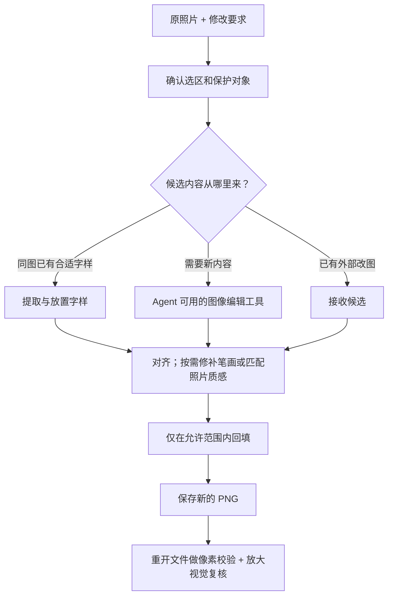

# PatchLock · 锁域修图

**让 AI 提供候选，让原照片决定哪里能改。**

PatchLock 是一个面向**真实照片局部修改**的 Agent Skill。你告诉 Agent 想改什么，它按技能中的流程准备素材、调用可用的图像编辑工具或借用照片里的字样，再把需要的内容贴回原图，并检查修改有没有越界。

例如，把书脊上的「大水」改成「小水」：需要替换「大」，也要尽量匹配原来的印刷风格、拍摄透视和蓝色底纹，同时保留旁边的「水」、其他书籍和照片背景。

PatchLock 的核心价值是**控制修改范围、组织局部修图流程，并留下可以检查的证据**。候选内容仍需足够好；局部回填不会自动修好错误的字形或凭空恢复被遮住的细节。

## 它和直接让 AI 改图有什么区别

直接让图像模型改照片时，即使只要求改一个字，返回的候选也可能改变整张图片的尺寸、构图、色调或其他细节。PatchLock 会把原图保留下来，只从候选里接收指定区域的内容。

| 环节 | 谁负责 | 你能得到什么 |
|---|---|---|
| 新字、物体或干净背景从哪里来 | 当前 Agent 的图像编辑工具、同图字样，或你提供的外部候选 | 可用于修改的内容 |
| 候选和原照片怎样对上 | 本地背景配准，或确认过的四角对应关系 | 位置与透视映射；不可靠时停止 |
| 哪些地方可以改变 | 任务选区、编辑蒙版和保护蒙版 | 明确的允许修改范围 |
| 怎样融入照片 | 可选的笔画修补、颜色与平滑光照匹配、模糊或颗粒处理 | 更便于检查的局部候选 |
| 有没有改到其他地方 | 重开最终 PNG，逐像素比较 | 范围校验、变化图和报告 |
| 看起来是否自然、文字是否正确 | Agent 的视觉检查与必要的人工复核 | 与像素范围结论分开记录的质量判断 |

**Skill 是供 Agent 遵循的操作说明和本地工具集合，不是一个独立的修图模型或在线网站。** 本仓库的脚本不调用网络或模型，也不包含生成额度。使用现有候选和本地工具不需要 API Key；如果需要生成新内容，仍取决于宿主 Agent 是否提供图像编辑能力及相应使用权限。

## 适合怎样的照片

- **书脊、招牌、包装上的局部改字**：改变某个字或数字，保留周围印刷内容。
- **同一张照片里的字样复用**：照片其他位置已有合适字符时，借用它的实际笔画、颜色和清晰度。
- **小范围物体修补**：将已有候选里的局部物体贴回原图。没有候选时，需要图像编辑工具先生成内容。
- **修复 AI 改图的连带变化**：你已经得到一张改图，但只想保留其中一处修改。

大幅重构构图、重新设计整张海报、恢复无法辨认的小字，或自动重建弯曲瓶身和折皱上的文字，不属于目前可靠的本地工具能力。

## 直接向 Agent 使用

安装后，附上原照片并说明要改的内容。一般不需要自己写命令；Agent 会根据图片和要求选择流程。目标有多处、供体不明确或保护范围存在歧义时，仍需要确认。

### 场景一：修改照片里的一个字

> 使用 $patchlock，把这张照片蓝色书脊上的「大水」改成「小水」。只替换「大」，匹配原来的字形、透视和照片质感，保留「水」及其他内容。请交付结果、局部对比和范围校验。

Agent 会先检查原图，确定原生像素坐标中的选区。如果照片里没有可借用的「小」，它需要通过当前环境的图像编辑工具获得候选，而不是从本地脚本里生成新字。

### 场景二：只保留已有 AI 改图中的一处修改

> 使用 $patchlock。第一张是原照片，第二张是 AI 改过的候选。我只想保留书脊上这个字的修改，其他地方以第一张为准。请先对齐，再局部回填并检查是否越界。

请明确哪张是原图、哪张是候选。候选里的无关变化不会整体复制到最终结果；但候选在允许区内的错误、残影或模糊仍可能被带入，需要视觉检查。

### 场景三：借用同图字样

> 使用 $patchlock，把这里的数字替换成照片右上角已有的那个数字。借用原照片里的字样，按目标位置调整透视；清除旧笔画，保留邻字和底纹。

字样提取工具需要一个明确的供体位置。它能提取和放置已存在的字样，不执行 OCR、自动字体识别或缺失字符合成。

## 一次修改怎样完成



这里有两个不同的判断：

- **范围正确**：允许区域之外的解码 RGBA 像素没有变化。这可以由脚本核验。
- **视觉正确**：目标内容改对了，字形、颜色、边缘、透视和背景自然。这不能只靠变化计数或几个统计指标证明。

即使整张图完全没有变化，范围校验也可能通过。因此报告会检查无变化情况，而不会把“没有越界”当成“已经改好”。

## 安装与依赖

需要能读取本地 Skills、执行本地 Python 工具的 Agent 环境，以及 **Python 3.10+**。需要生成候选时，宿主还必须提供图像编辑能力；没有该能力，也可以使用你提供的候选图。

### 安装 Skill

将仓库内容放入技能目录下的 `patchlock/`。默认 Codex 个人技能路径为 `~/.codex/skills/patchlock/`；使用自定义技能目录时按实际配置放置。

Windows PowerShell 示例，适用于目标目录尚不存在时：

```powershell
git clone https://github.com/BGrowl/patchlock-skill.git "$env:USERPROFILE\.codex\skills\patchlock"
Set-Location "$env:USERPROFILE\.codex\skills\patchlock"
python -m pip install -r requirements-alignment.txt
```

也可以下载仓库 ZIP，解压并将文件夹命名为 `patchlock`。检查 `patchlock/SKILL.md` 能直接找到，避免多套一层 `patchlock/patchlock-skill-main/`。已有安装请先备份本地修改，再更新文件。

### 选择依赖

| 使用哪些工具 | 安装命令 |
|---|---|
| 基础合成、范围验证、同图字样、质量报告 | `python -m pip install -r requirements.txt` |
| 再加自动背景配准、照片匹配、旧笔画修复 | `python -m pip install -r requirements-alignment.txt` |

`requirements-alignment.txt` 已包含基础依赖，无需重复安装。Pillow 是基础图像依赖，NumPy 和 OpenCV 用于可选分析、配准和修复。脚本不会自行安装依赖或主动弹出额外 GUI 窗口。

## 想自己运行命令：一个完整例子

以下命令从仓库根目录执行。假设你已有原照片 `photo.jpg` 和一张**整图构图的已编辑候选** `candidate.png`。示例中的坐标只是演示，必须换成自己照片的实际选区。

### 1. 建立任务

```shell
python -B scripts/photo_patch.py prepare --image photo.jpg --rect 100 120 80 60 --prompt "只修改选中位置的文字，保留其他内容" --workdir work/task
```

`--rect` 依次为 `x y width height`，原点在左上角。坐标基于应用 EXIF 方向后的原生像素，不是聊天缩略图或网页显示尺寸。

这一步生成：

```text
work/task/
├── original.png      方向归一化后的原图，供后续合成与校验
├── reference.png     带周围上下文的干净局部参考图
├── allowed-mask.png  初始允许区域，白色允许、黑色禁止
├── instructions.txt  供图像编辑工具使用的修改说明
└── task.json         尺寸、坐标、要求与原图哈希
```

**prepare 不会生成修改内容。** 需要生成候选时，把 `reference.png` 和说明交给可用的图像编辑工具；已有整图候选时，可以直接进入下一步。

### 2. 对齐、局部回填并生成报告

```shell
python -B scripts/salvage.py --task work/task/task.json --candidate candidate.png --frame photo --output work/result.png
```

默认使用未改背景做自动配准。如果背景特征不足、候选缺失目标区域或对应关系不可靠，会拒绝继续，不会静默改成拉伸。

只有已经确认候选保持相同构图时，才使用 `--alignment identity`。相同尺寸或宽高比本身不足以作出这个确认。

### 3. 检查输出

```text
work/
├── result.png                最终照片
├── result.allowed.png        本次有效允许范围
├── result.diff.png           实际变化位置，白色代表有 RGBA 变化
├── result.verification.json  重开 PNG 后的像素范围证据
├── result.quality.json       质量指标、警告与复核状态
├── result.quality.html       可离线打开的原图/结果/变化局部对比
├── result.salvage.json       输入输出哈希、映射与处理记录
└── result.salvage/           配准及可选匹配的中间材料
```

先检查范围和无变化警告，再放大看结果。HTML 的内嵌预览最长边上限为 1200 像素，大裁切会缩小；检查细笔画时仍应查看最终 PNG 的原生像素。

所有输出使用新名称，已有文件不会被覆盖。失败时可能保留中间证据；重试请使用新的输出名。

## 几个容易混淆的概念

### 原图、候选和 frame

**原图**是最终画布的依据。**候选**是可以取材的修改结果，可能来自模型，也可能来自本地字样或修补工具。候选不是默认交付的整张照片。

`--frame` 声明候选对应原图中的哪段画面：

| 值 | 候选内容 | 典型来源 |
|---|---|---|
| `photo` | 整张照片的画面 | 外部 AI 整图改图，或本地全尺寸候选 |
| `reference` | 完整的 `reference.png` 局部画面 | 对 prepare 生成的参考图进行编辑 |
| `patch` | 只有任务矩形内的内容 | 已明确位置的局部补丁 |

不要为了通过检查而随便换 frame。有裁切或漂移时，需要可信配准或四角映射来还原对应关系，不能按尺寸猜测。仅有 patch 时缺少未改背景，不能使用默认自动配准，需要确认的映射或明确的 identity 声明。

### 编辑蒙版与保护蒙版

蒙版是指定哪些像素允许变化的图。最容易理解的格式是与归一化原图同尺寸的不透明灰度 PNG。

- **编辑蒙版**：白色允许修改，黑色保留原图。
- **保护蒙版**：白色必须保护，黑色不额外保护。
- **任务矩形**：最终允许范围始终受它限制，蒙版不会把权限扩展到矩形外。

基础合成中，编辑与保护蒙版共同收紧允许范围，保护优先。灰度权重、alpha 和笔画工具的严格保护语义有差异，制作软边或透明蒙版前请阅读 [完整蒙版规则](references/photo-tools.md#stroke-level-background-preservation)。

### 同图借字为什么还需要清除旧字

把一个透明的「小」贴上去，并不会让底下的「大」消失。需要先修复旧笔画覆盖的背景，再贴新笔画。

`photo_finish.py strokes` 根据旧、新笔画蒙版完成这件事，并输出二者的有效并集作为最终编辑蒙版。只使用新笔画蒙版，会让新笔画之外的旧字残留。背景插值适合窄笔画和平滑区域；复杂底纹和反光并不能保证重建正确。

字样提取还可能保留原背景混入笔画边缘的颜色。透明提取不等于已经去除这些颜色污染，仍需在实际目标底色上检查。详见 [同图字样指南](references/donor.md)。

## 五类工具怎么配合

| 你遇到的情况 | 工具与处理方式 | 需要留意什么 |
|---|---|---|
| 原照片里已有合适字样 | `glyph_sample.py sample/place`：提取深/浅色字样，记录样本特征，按目标四角放置 | 供体需明确；不识字、不找字体、不生成缺字 |
| 旧字和新字形状不同 | `photo_finish.py strokes`：修复旧笔画、贴入新笔画，生成并集蒙版 | 旧蒙版需覆盖旧笔画及抗锯齿；邻字需保护 |
| 候选底色、光照或清晰度不协调 | `photo_finish.py match`，或 `salvage.py --sample-mask` | 样本必须是确认未改的背景；不能包含任务修改区 |
| 外部 AI 连带改变了其他地方 | `salvage.py`：配准、可选匹配、保护合成和报告 | 只回填允许范围，但不会自动纠正范围内的错误内容 |
| 想检查已经保存的结果 | `quality_report.py`，或 salvage 自动生成的报告 | 指标是诊断；文字含义与旧字残影仍需视觉复核 |

照片匹配默认 `additive`，使用有界颜色偏移与平滑光照修正。`affine` 还会拟合 RGB 增益，需要明确选择；从单一蓝底拟合的增益外推到白字时可能使字偏色。模糊和颗粒也是可选效果，不会自动添加。

不同有效 ICC 色彩配置可以转换；只有一张图片没有 ICC 时，默认拒绝匹配。确认未标记图实际为 sRGB 后，才使用 `--assume-untagged-srgb`，报告会记录这个假设。该选项执行转换，不只是给原字节换一个标签。

更多命令与参数：

- [基础任务、候选映射、蒙版与像素校验](references/workflow.md)
- [同图字样提取与四角放置](references/donor.md)
- [照片匹配、笔画修复与候选回填](references/photo-tools.md)
- [质量报告的指标、阈值和限制](references/quality.md)

## 报告怎样读

| 字段或状态 | 含义 | 不代表什么 |
|---|---|---|
| `changed_outside_allowed = 0` | 没有允许范围外的 RGBA 像素变化 | 不代表范围内的字已经改对 |
| `pixel_scope_pass = true` / `scope_pass = true` | 像素范围校验通过 | 不代表字体、接缝、色彩自然 |
| `changed_inside_allowed > 0` | 允许范围内确实发生了变化 | 不代表变化符合要求 |
| `no_op` | 原图与结果没有任何像素变化 | 不能作为修图成功交付 |
| `review_required` | 已产生可检查结果，仍需视觉复核 | 不是自动的质量通过 |
| `fail` | 范围失败，或调用方提供的实际观察文字与期望文字不一致 | 不会因为接缝指标低就改判通过 |

质量报告还提供新增边界跳变、清晰度与纹理统计。这些是帮助定位疑点的启发式指标，不是“无痕分数”。脚本不执行 OCR；`observed_text` 只能填写独立人眼或外部 OCR 实际观察到的内容，不能直接复制期望文字充当观察结果。

`salvage` 或质量报告命令返回退出码 0 表示成功产出了待审结果，不表示视觉质量通过。它们在已知失败或无效输入时退出 2；判断结果请同时阅读报告与实际图片。

## 常见问题

**为什么最终输出 PNG？**

JPG 重新保存通常会重新压缩整张图，导致选区外像素变化。严格范围交付使用 PNG。校验比较的是 EXIF 方向归一化后的解码 RGBA 像素，不是原 JPEG 文件字节、压缩结构或全部元数据。

**自动配准失败，可以强行用 identity 吗？**

只有另有证据确认构图一致时才可以。配准失败可能意味着纹理不足，也可能意味着候选被裁切、局部重绘或变形。应提供可信对应点、完整候选或重新生成，而不是仅凭宽高比拉伸。

**没有图像编辑工具，还能使用吗？**

可以处理已有候选、借用同图字样、做本地回填和报告。没有合适字样或候选时，本地脚本不能单独生成你想要的新字或新物体。

**是不是全自动精确改字？**

目前需要 Agent 结合视觉判断来定位、选择供体与制作或确认蒙版。脚本负责可重复的图像处理和范围证据；自动 OCR、字体识别、复杂曲面重建没有实现。

**为什么匹配后还是可能不自然？**

配准解决几何对应，颜色匹配解决有限的色彩和光照差异。错误笔画、旧字残影、折皱、反光和失真的纹理需要分别处理。低误差或范围通过无法替代放大检查，也不承诺“无瑕”或“不可检测”。

**大照片能处理吗？**

单张输入上限为 4000 万像素。可选 NumPy 工具接近上限时可能需要约 2 GB 或更多内存；资源受限时优先使用原生分辨率局部素材，并保持任务、候选和蒙版坐标一致。预览放大不等于恢复细节。

## 验证与项目结构

完整测试需要先安装 `requirements-alignment.txt`：

```shell
python -B -m unittest discover -s scripts -p "test_*.py" -v
```

当前有 **67 项本地测试**，覆盖保护范围、透明度、EXIF 方向、裁切与透视、同图字样、照片匹配、色彩配置、笔画修复、候选回填及报告输出。测试使用临时合成素材，不调用模型或网络。

开发期间还做过真实书脊照片验证：一次默认光照匹配回填中，允许区域内改变 11,984 个像素，区域外改变 0 个像素；底色接缝减轻，但字迹仍偏软，浅色斜痕仍需复核。这是一个实例的结果，不是对所有照片的效果保证。包含用户照片的验证材料未纳入公开仓库。

```text
patchlock/
├── SKILL.md                    Agent 的任务路由与操作约束
├── agents/openai.yaml          Skill 的显示与调用信息
├── references/                 各工具的详细工作流和限制
├── scripts/
│   ├── photo_patch.py          准备任务、局部合成、独立范围校验
│   ├── register_candidate.py   未改背景自动配准
│   ├── glyph_sample.py         同图字样提取与透视放置
│   ├── photo_finish.py         照片匹配与笔画级背景修复
│   ├── salvage.py              已有候选的完整回填流程
│   ├── quality_report.py       离线质量证据与局部对比
│   └── test_*.py               本地测试
├── requirements.txt            Pillow 基础依赖
└── requirements-alignment.txt  基础依赖 + NumPy/OpenCV
```
